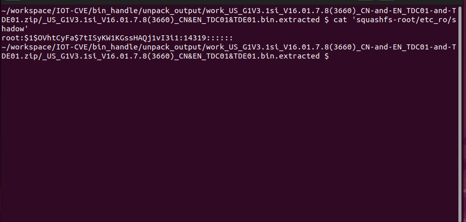
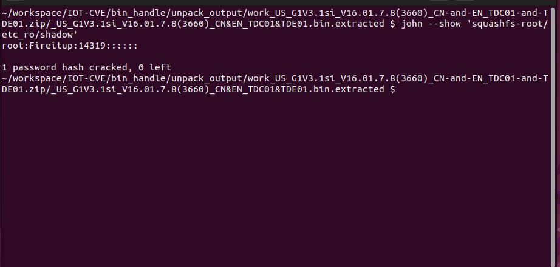

# Tenda G1V3.1si V16.01.7.8 was discovered to contain a hardcoded password vulnerability

## Overview
Product: G1V3.1si

Version: V16.01.7.8

Manufacturer's website information: https://www.tendacn.com/

## Affected version
V16.01.7.8

## Vulnerability description
Tenda G1V3.1si V16.01.7.8 was discovered to contain a hardcoded password vulnerability in /etc_ro/shadow, which allows attackers to log in as root. By supplying the specific input an attacker can trigger the use of embedded hard-coded credentials. This vulnerability is restricted to local access and demands a sophisticated level of execution, making it relatively challenging to exploit. Nevertheless, the Proof of Concept (PoC) has been released to the public and could be weaponized.





## Additional Information
```markdown
### Vendor
Tenda

### Product
G1V3.1si

### Version or Commit
V16.01.7.8

### Vulnerability Class
CWE-798 Use of Hard-coded Credentials

### Description
Tenda G1V3.1si V16.01.7.8 ships a hardcoded root password in /etc_ro/shadow. An attacker who obtains the firmware image can recover the password and log in as root.

### Product_version
G1V3.1si

V16.01.7.8

### Affected_component
/etc_ro/shadow

### Attack_vector
The root password obtained from /etc_ro/shadow, can be used for unauthorized root login.

### Technical_details
Tenda G1V3.1si V16.01.7.8 Firmware V16.01.7.8 was discovered to contain a hardcoded password vulnerability in /etc_ro/shadow, which allows attackers to log in as root

### Reference
- https://www.tendacn.com/
- https://github.com/vuln-1/vuln/blob/main/Tenda/G1V3.1si_V16.01.7.8/report-1.md

```
