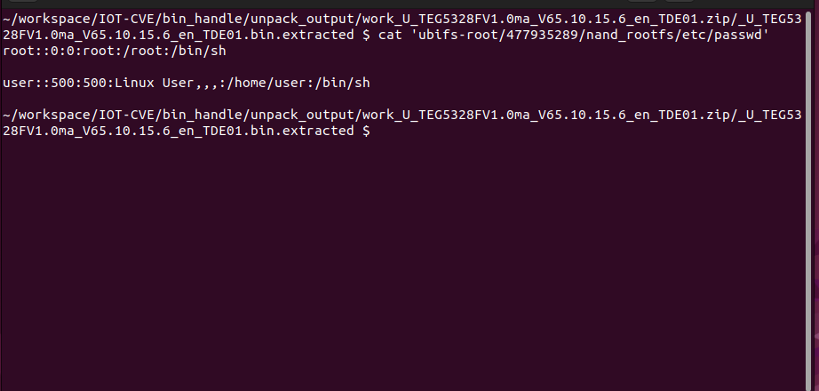
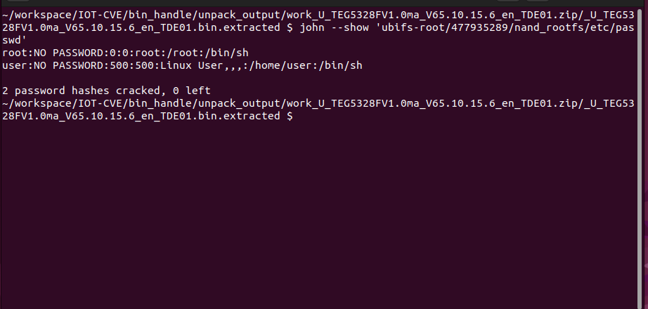

# Tenda TEG5328FV1.0ma V65.10.15.6 was discovered to contain a hardcoded password vulnerability

## Overview
Product: TEG5328FV1.0ma

Version: V65.10.15.6

Manufacturer's website information: https://www.tendacn.com/

## Affected version
V65.10.15.6

## Vulnerability description
Tenda TEG5328FV1.0ma V65.10.15.6 was discovered to contain a hardcoded password vulnerability in /etc/passwd, which allows attackers to log in as root. By supplying the specific input an attacker can trigger the use of embedded hard-coded credentials. This vulnerability is restricted to local access and demands a sophisticated level of execution, making it relatively challenging to exploit. Nevertheless, the Proof of Concept (PoC) has been released to the public and could be weaponized.





## Additional Information
```markdown
### Vendor
Tenda

### Product
TEG5328FV1.0ma

### Version or Commit
V65.10.15.6

### Vulnerability Class
CWE-798 Use of Hard-coded Credentials

### CVE_status
CVE application in progress

### Description
Tenda TEG5328FV1.0ma V65.10.15.6 ships a hardcoded root password in /etc/passwd. An attacker who obtains the firmware image can recover the password and log in as root.

### Product_version
TEG5328FV1.0ma

V65.10.15.6

### Affected_component
/etc/passwd

### Attack_vector
The root password obtained from /etc/passwd, can be used for unauthorized root login.

### Technical_details
Tenda TEG5328FV1.0ma V65.10.15.6 Firmware V65.10.15.6 was discovered to contain a hardcoded password vulnerability in /etc/passwd, which allows attackers to log in as root

### Reference
- https://www.tendacn.com/
- https://github.com/vuln-1/vuln/blob/main/Tenda/TEG5328FV1.0ma_V65.10.15.6/report-1.md

```
