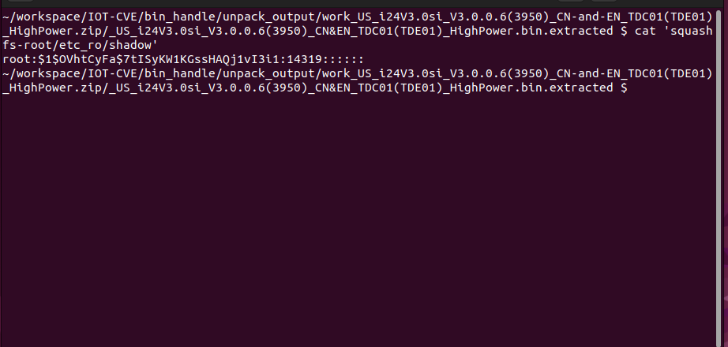
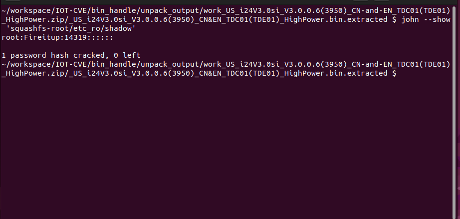

# i24V3.0si was discovered to contain a hardcoded password vulnerability

## Overview
Product: i24V3.0si

Version: V3.0.0.6

Manufacturer's website information: https://www.tendacn.com/

## Affected version
V3.0.0.6

## Vulnerability description
Tenda i24V3.0si V3.0.0.6 was discovered to contain a hardcoded password vulnerability in /etc_ro/shadow, which allows attackers to log in as root. By supplying the specific input an attacker can trigger the use of embedded hard-coded credentials. This vulnerability is restricted to local access and demands a sophisticated level of execution, making it relatively challenging to exploit. Nevertheless, the Proof of Concept (PoC) has been released to the public and could be weaponized.





## Additional Information
```markdown
### Product_version
i24V3.0si

V3.0.0.6

### Affected_component
/etc_ro/shadow

### Attack_vector
The root password obtained from /etc_ro/shadow, can be used for unauthorized root login.

### Discription
Tenda i24V3.0si V3.0.0.6 Firmware V3.0.0.6 was discovered to contain a hardcoded password vulnerability in /etc_ro/shadow, which allows attackers to log in as root

### Reference
- https://www.tendacn.com/
- https://github.com/vuln-1/vuln/blob/main/Tenda/i24V3.0si_V3.0.0.6/report-1.md


```

